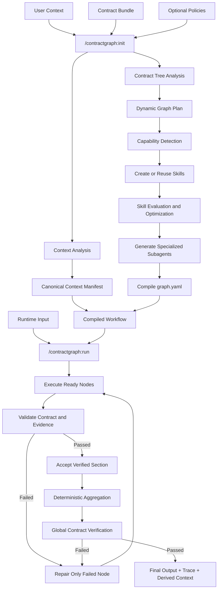

# ContractGraph

## Project Purpose

ContractGraph is a Claude Code-native graph-engineering workflow.

It converts:

1. user-provided context,
2. user-provided contracts,
3. optional execution policies,

into a dynamically generated workflow composed of reusable skills, specialized subagents, explicit dependencies, verification gates, retries, aggregation, and final outputs.

ContractGraph is not a Python agent framework, web application, API service, or database-backed platform.

## Non-Negotiable Boundaries

- Use Claude Code as the workflow runtime.
- Do not use LangGraph.
- Do not use the Anthropic SDK.
- Do not use external model APIs.
- Do not require API keys.
- Do not introduce FastAPI, Flask, Django, Node servers, databases, queues, or background services.
- Do not hard-code company research, study planning, resume analysis, or any other domain workflow into the framework core.
- Do not require the user to manually design the workflow graph.
- Do not place private user information inside generated skills or agent definitions.
- Use small local scripts only for deterministic operations.

## Core Abstraction

```text
Context defines what is already known.
Contracts define what must be produced.
Policies define what is allowed.
Claude Code designs how the workflow executes.
```

The user provides two mandatory inputs:

```text
context/
contracts/
```

Claude Code compiles them into:

```text
runtime/compiled/
├── graph.yaml
├── context-manifest.json
├── contract-manifest.json
├── skill-manifest.json
├── agent-manifest.json
└── compilation-report.md
```

## Architecture



## Context Model

Context is evolving, but every fact must retain its origin.

### Canonical Context

Canonical context is supplied directly by the user and is treated as ground truth.

Examples:

```text
context/canonical/
├── profile.md
├── resume/
├── skills.md
├── experience.md
├── projects/
├── certifications/
└── preferences.md
```

Rules:

- Never silently modify canonical context.
- Never infer missing personal facts and store them as truth.
- Preserve the source path for every extracted fact.
- Summarize large documents when useful.
- Load original documents when exact evidence is required.
- Use OCR only when normal extraction produces no usable text.

### Derived Context

Derived context is created from verified workflow outputs.

Examples:

```text
context/derived/
├── companies/
├── study-plans/
├── resume-analysis/
└── research-history/
```

Every derived item must include:

- source run ID,
- generating node,
- creation time,
- evidence references,
- confidence,
- freshness information,
- contract version.

Derived context must never overwrite canonical context.

## Contract Model

A contract describes the required final output.

A main contract may contain multiple subcontracts.

Example:

```text
Company Research Contract
├── Company Intelligence
├── Public Projects and Initiatives
├── DSA
├── HLD
├── LLD
├── Behavioral
├── Profile Alignment
└── Resume Analysis
    ├── AI Engineer
    ├── Forward Deployed Engineer
    ├── Backend Engineer
    ├── SDE-1 or SDE-2
    └── ML Engineer
```

Rules:

- Each subcontract becomes one node or one subtree.
- Contract structure does not automatically define execution order.
- Claude Code must infer dependencies from data requirements.
- Independent nodes may execute in parallel.
- Dependent nodes must wait for verified prerequisites.
- The final output must conform exactly to the main contract.
- A node is complete only when its subcontract validates and its verifier passes.

## Initialization Workflow

`/contractgraph:init` must:

1. inspect all contracts,
2. build the contract tree,
3. inspect canonical context,
4. generate context summaries and references,
5. detect required capabilities,
6. search the existing skill registry,
7. reuse suitable verified skills,
8. create only missing skills,
9. evaluate and improve generated skills,
10. generate specialized subagents,
11. assign models, tools, budgets, and skills,
12. infer node dependencies,
13. compile the workflow graph,
14. validate the compiled workflow,
15. write the compilation report.

Initialization should rerun only when contracts, canonical context, policies, or core skill definitions change.

## Skill Creation Rules

Skills are reusable capabilities, not workflow-specific prompts.

Use the skill-creator skill to create and improve skills.

A generated skill must:

- solve one clear reusable capability,
- have a precise trigger description,
- include a bounded procedure,
- define expected inputs and outputs,
- define evidence and quality requirements,
- define failure behavior,
- avoid private user facts,
- avoid company-specific or run-specific details,
- avoid duplicating another skill,
- remain concise enough to preload without wasting context.

Examples of reusable capabilities:

```text
contract decomposition
evidence-backed web research
source quality assessment
freshness verification
profile alignment
resume evidence mapping
schema repair
cross-section contradiction detection
skill quality evaluation
```

Do not create one large skill containing the entire workflow.

Do not create many overlapping skills with slightly different names.

Every skill must be evaluated for:

- correct triggering,
- false triggering,
- output quality,
- contract usefulness,
- token overhead,
- duplication,
- privacy leakage.

## Subagent Rules

Subagents are generated from the compiled graph.

Each subagent must have:

- one bounded responsibility,
- explicit input contract,
- explicit output contract,
- required skills only,
- minimum necessary tools,
- model assignment,
- token and search budget,
- retry policy,
- evidence requirements,
- clear stop conditions.

A subagent may complete its node.

A subagent must never declare the entire workflow complete.

## Model Routing

Default routing:

```text
Haiku:
- lightweight triage,
- source deduplication,
- simple formatting repair,
- low-risk extraction.

Sonnet:
- graph-plan drafting,
- primary research,
- contract interpretation,
- profile alignment,
- semantic repair.

Opus:
- graph-plan supervision,
- difficult skill criticism,
- top-level adjudication,
- global contradiction checking,
- final verification.
```

Use Opus selectively.

Do not send complete raw research outputs to Opus when compact evidence summaries are sufficient.

## Execution Rules

`/contractgraph:run` must:

1. load the compiled graph,
2. resolve runtime input,
3. calculate valid cache keys,
4. skip only sections with valid cache entries,
5. execute ready nodes,
6. parallelize only independent nodes,
7. validate every node output,
8. retry only failed nodes,
9. preserve raw evidence,
10. aggregate only accepted outputs,
11. run global verification,
12. write final outputs and traces,
13. create derived context only from verified results.

## Validation and Completion

Validation has three layers.

### Structural Validation

Use deterministic scripts to check:

- valid JSON,
- required fields,
- field types,
- enum values,
- nested subcontract structure,
- forbidden extra fields when disallowed.

### Semantic Verification

Use a verifier subagent to check:

- evidence supports claims,
- sources are credible,
- freshness requirements are met,
- profile alignment uses canonical context,
- contradictions are identified,
- unsupported claims are rejected.

### Global Verification

Use Opus to check:

- all required subcontracts are complete,
- cross-section claims are consistent,
- rankings are justified,
- references resolve correctly,
- the final artifact satisfies the main contract.

A node is accepted only when structural validation and semantic verification both pass.

The workflow is complete only when global verification passes.

## Deterministic Utilities

Small local scripts are allowed only for:

```text
document extraction
OCR fallback
hashing
context indexing
JSON Schema validation
JSON merging
cache-key generation
TOON conversion
token-size comparison
trace formatting
```

These scripts must not:

- call model APIs,
- implement agent reasoning,
- choose research conclusions,
- replace Claude Code orchestration,
- become a general application framework.

JSON is always the canonical format.

TOON is optional and may be used only when measured token savings do not reduce correctness.

## Token Efficiency

- Reuse verified skills.
- Give each node only relevant context.
- Prefer references and summaries over full-document duplication.
- Cache by contract version, context hash, runtime input, node version, and skill version.
- Retry only failed nodes.
- Do not run Opus for routine extraction.
- Do not preload unrelated skills.
- Do not pass full transcripts between nodes.
- Preserve structured state instead of conversation history.
- Benchmark TOON against minified JSON before enabling it.

## Privacy

- Keep canonical private context under `context/private/`.
- Keep personal outputs under ignored runtime directories.
- Never copy private facts into public examples.
- Never embed resume text, personal identifiers, or project secrets into skills.
- Generated skills and agents must be safe to publish after removing runtime references.
- Public examples must use synthetic context.

## Expected Repository Shape

```text
contractgraph/
├── CLAUDE.md
├── .claude/
│   ├── commands/
│   ├── skills/
│   │   ├── bootstrap/
│   │   ├── reusable/
│   │   └── generated/
│   ├── agents/
│   │   └── generated/
│   └── settings.json
├── contracts/
├── context/
│   ├── canonical/
│   ├── derived/
│   ├── private/
│   └── synthetic/
├── scripts/
├── runtime/
│   ├── compiled/
│   ├── cache/
│   ├── runs/
│   ├── sections/
│   ├── traces/
│   └── outputs/
├── evals/
└── docs/
```

## Definition of Done

A workflow is ready only when:

- contracts parse successfully,
- canonical context is indexed,
- the graph is generated from contracts rather than hard-coded,
- skills are reusable and evaluated,
- generated subagents have bounded responsibilities,
- all dependencies are explicit,
- node contracts are machine-validatable,
- retries target only failed nodes,
- aggregation is deterministic,
- evidence and provenance are preserved,
- global verification passes,
- no external model API or application server is required.

## Current V1 Focus

The first private validation workflow is company research plus role-specific resume analysis.

This workflow is a test case, not the framework architecture.

The public demonstration may use a personalized study-plan contract with synthetic user context.

Design every core mechanism so both workflows use the same initialization, graph compilation, skill generation, execution, validation, and aggregation process.
