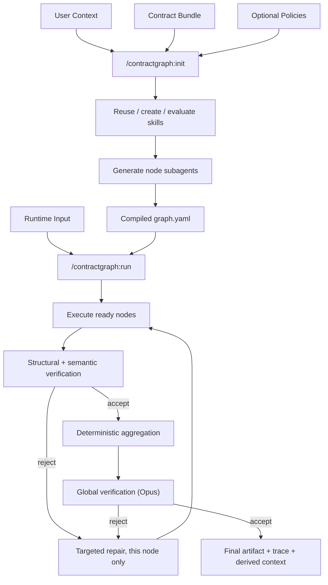

# ContractGraph

A Claude Code-native graph-engineering workflow. You provide **context** (what's already known) and **contracts** (what must be produced); Claude Code compiles both into a graph of skills, subagents, dependencies, verification gates, and retries — then executes it.

```text
Context defines what is already known.
Contracts define what must be produced.
Policies define what is allowed.
Claude Code designs how the workflow executes.
```

## What This Is Not

- Not a Python agent framework, web application, API service, or database-backed platform.
- No LangGraph, no Anthropic SDK, no external model API, no API key.
- No FastAPI/Flask/Django, no Node servers, no databases, queues, or background daemons.
- No domain workflow (company research, resume analysis, study planning, or anything else) hard-coded into the framework core — every domain lives entirely in `contracts/<workflow>/` and `context/`.

Python exists only for small, deterministic utilities — hashing, JSON Schema validation, cache-key generation, trace formatting. It never calls a model, never implements agent reasoning, and never chooses a research conclusion. Claude Code is the only orchestration and reasoning runtime. JSON is the canonical interchange format everywhere; TOON is implemented but disabled until a measured benchmark proves it doesn't cost correctness.

## Context vs. Contract

| | Context | Contract |
|---|---|---|
| Answers | What do we already know? | What must the output contain? |
| Kinds | canonical (ground truth), derived (from verified runs), private (PII, git-ignored) | main contract + node subcontracts, each independently verifiable |
| Mutability | canonical is immutable during a run; derived is append-only | fixed for the duration of a compiled graph |
| Lives in | `context/canonical/`, `context/derived/`, `context/private/` | `contracts/<workflow>/` |

Full detail: [docs/context-model.md](docs/context-model.md), [docs/contract-model.md](docs/contract-model.md).

## Two Planes

| Plane | Command | Input | Output |
|---|---|---|---|
| **Init** (compile-time) | `/contractgraph:init` | contract bundle + canonical context + policies | `runtime/compiled/` — graph, manifests, reused/generated skills, generated subagents |
| **Run** (execution-time) | `/contractgraph:run` | compiled graph + runtime input | `runtime/runs/<run-id>/` — sections, evidence, verification verdicts, final artifact, trace, derived context |

Two commands sit upstream of `init`: `/contractgraph:context` scaffolds a minimal context tree, `/contractgraph:contract` designs a contract bundle. `/contractgraph:validate` runs deterministic structural checks independent of either plane.



## Initialization

`/contractgraph:init` inspects your contract tree and canonical context, detects the capabilities the bundle needs, reuses or creates the skills that satisfy them, generates one bounded subagent per node, infers dependencies from actual data needs (not contract nesting), compiles the graph, and validates the result before writing anything. Nothing is hard-coded per workflow — the identical procedure produces a company-research graph and a study-plan graph from two unrelated bundles. See [docs/graph-compilation.md](docs/graph-compilation.md).

## Generated Skills and Subagents

Skills are reusable capabilities (`evidence-backed-web-research`, `source-quality-assessment`, `freshness-verification`, ...), not workflow-specific prompts, tiered as `bootstrap/` (build the framework), `reusable/` (verified, cross-bundle), and `generated/` (bundle-specific until reuse promotes them). Every skill is evaluated for correct/false triggering, output quality, token overhead, duplication, and privacy leakage before acceptance. See [docs/skill-lifecycle.md](docs/skill-lifecycle.md) and [docs/skill-generation.md](docs/skill-generation.md).

Subagents are compiled 1:1 from node contracts — one bounded responsibility, explicit input/output contract, minimum necessary tools, an assigned model tier, a token/search budget, a retry policy, and explicit prohibitions (it can never approve its own output or declare the whole workflow complete). See [docs/agent-generation.md](docs/agent-generation.md).

## Execution and Verification

`/contractgraph:run` walks the compiled graph layer by layer, dispatching only nodes whose dependencies are already `ACCEPTED`, in parallel where independent, capped by policy. Every node output passes three layers before acceptance:

1. **Structural** — deterministic JSON Schema validation.
2. **Semantic** — an independent verifier subagent checks evidence, source credibility, freshness, and cross-section consistency; it can accept or reject, never fix.
3. **Global** — after deterministic aggregation, an Opus-routed pass checks the merged artifact against the bundle's global rules and its main schema.

A rejection triggers a targeted repair of only the failed node, never a full restart. See [docs/execution.md](docs/execution.md) and [docs/validation.md](docs/validation.md).

## Example Commands

```text
/contractgraph:validate contracts/company-research
/contractgraph:init contracts/company-research
/contractgraph:run --input "Acme Corp" --roles ai-engineer,backend-engineer
```

Full walkthrough, including the public study-plan example below: [docs/getting-started.md](docs/getting-started.md).

## Private Context Handling

`context/private/` is git-ignored and excluded, unconditionally and by path, from every deterministic script, every skill, and every generated agent. Personal run outputs live under ignored `runtime/` subdirectories, never in tracked source. Derived context always carries provenance (source run, generating node, evidence refs, confidence, freshness, contract version) and never overwrites canonical context. See [docs/privacy.md](docs/privacy.md).

## Public Example: Study Plan

The company-research bundle in this repository uses real, private canonical context and is not meant for publication. The public demonstration of the same mechanism is a synthetic study-plan workflow — a fabricated learner profile under `context/synthetic/`, run through the identical `/contractgraph:{context,contract,init,validate,run}` sequence, the identical skill-generation and agent-generation procedure, and the identical three-layer verification model. It exists specifically to prove genericity: if it ever needed a framework-code change to work, that would be a regression. See [docs/evaluation.md](docs/evaluation.md) and [docs/adding-a-workflow.md](docs/adding-a-workflow.md).

## Current Limitation: Claude Code-First

ContractGraph currently assumes Claude Code as the only orchestration runtime — commands, subagent dispatch, and tool access are all Claude Code primitives (slash commands, the `Task` tool, generated `.claude/agents/` definitions). There is no adapter layer today; porting the compiled graph to a different agent runtime would require hand-translating the dispatch and tool-access model.

**Future — not implemented today:** portability via adapters, so a compiled `graph.json` could in principle be executed by a different agent runtime without changing any contract, skill, or agent definition. This is documented here as a direction, not a plan in progress — no adapter code, interface, or timeline exists yet.

## Documentation Index

| Doc | Covers |
|---|---|
| [docs/architecture.md](docs/architecture.md) | Core abstraction, two planes, repository shape |
| [docs/context-model.md](docs/context-model.md) | Canonical/derived/private context, the context manifest |
| [docs/contract-model.md](docs/contract-model.md) | Main contract, node subcontracts, `x-contractgraph`, contract creation modes |
| [docs/graph-compilation.md](docs/graph-compilation.md) | The full `/contractgraph:init` compile sequence |
| [docs/skill-lifecycle.md](docs/skill-lifecycle.md) | Skill tiers, registry, reuse vs. regeneration |
| [docs/skill-generation.md](docs/skill-generation.md) | How a skill is authored, evaluated, and bound to a node |
| [docs/agent-generation.md](docs/agent-generation.md) | How a node subagent is generated from its contract |
| [docs/execution.md](docs/execution.md) | The `/contractgraph:run` lifecycle, run directory, node state machine |
| [docs/validation.md](docs/validation.md) | Structural, semantic, and global validation; the verifier contract |
| [docs/token-efficiency.md](docs/token-efficiency.md) | Model routing, caching, evidence summaries, TOON gating |
| [docs/evaluation.md](docs/evaluation.md) | The eval suite categories and the two synthetic fixtures |
| [docs/privacy.md](docs/privacy.md) | Private context isolation, publish-safety bar |
| [docs/getting-started.md](docs/getting-started.md) | Install-free quickstart with both worked examples |
| [docs/adding-a-workflow.md](docs/adding-a-workflow.md) | Adding a new workflow with zero core-code changes |
