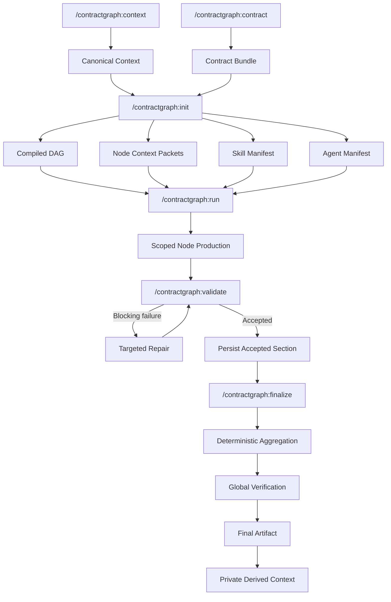

<div align="center">

# ContractGraph

**Contracts define what must be produced. Claude Code designs how it gets produced.**

A Claude Code-native graph-engineering framework. You supply *context* (what is already known) and *contracts* (what must be produced); ContractGraph compiles them into a verified DAG of scoped subagents, reusable skills, explicit dependencies, verification gates, and targeted repair — then executes it and proves the result against your contract.

[](https://github.com/Phoenixarjun/ContractGraph/actions/workflows/evals.yml)
[](LICENSE)
[](https://claude.com/claude-code)
[](https://www.python.org/)
[](#installation)

</div>

---

## Table of Contents

- [Why ContractGraph Exists](#why-contractgraph-exists)
- [What It Is Not](#what-it-is-not)
- [Architecture](#architecture)
- [Workflow Lifecycle](#workflow-lifecycle)
- [Installation](#installation)
- [Quick Start](#quick-start)
- [Commands](#commands)
- [Concepts](#concepts)
- [Repository Structure](#repository-structure)
- [Examples](#examples)
- [Limitations](#limitations)
- [Roadmap](#roadmap)
- [Contributing](#contributing)
- [License](#license)

---

## Why ContractGraph Exists

Multi-step agent work fails in predictable ways. An agent produces a plausible artifact that nobody can machine-check. One bad section forces a full re-run. Sources get cited that were never read. Context balloons until the model is reasoning over a transcript instead of a task. And the moment you want a *second* workflow, you discover the first one was hard-coded into the framework.

ContractGraph attacks each of those directly:

| Failure mode | What ContractGraph does instead |
|---|---|
| "Looks right" output nobody can verify | Every node output validates against a **JSON Schema**, then faces an **independent verifier subagent** that can reject but never rewrite |
| One failure re-runs everything | **Targeted repair** — only the failed node re-executes, carrying the verifier's exact JSON-path complaints |
| Unsupported claims and phantom sources | Claims cite `evidence[{ref, claims}]` against a run-level **source registry**, deduplicated by normalized URL, checked for completeness and reachability |
| Context bloat | Each node receives a compiled **context packet** — its own contract, its declared context refs by hash, and compact dependency summaries. Never the full bundle, never all canonical context, never an upstream node's raw output |
| Framework rewritten per use case | **Zero domain logic in the core.** A new workflow is a new `contracts/<workflow>/` directory and a new context tree — no script, skill, or command changes |
| Silent completion | A run is `COMPLETED` only when a deterministic finalizer says every check passed. Otherwise it is `FINALIZATION_FAILED`, by name |

The core abstraction is four lines:

```text
Context defines what is already known.
Contracts define what must be produced.
Policies define what is allowed.
Claude Code designs how the workflow executes.
```

## What It Is Not

- Not a Python agent framework, web application, API service, or database-backed platform.
- No LangGraph, no Anthropic SDK, no external model API, **no API key**.
- No FastAPI/Flask/Django, no Node servers, no databases, queues, or background daemons.
- No domain workflow hard-coded into the core — every domain lives in `contracts/<workflow>/` and `context/`.

Python exists only for small, deterministic utilities: hashing, JSON Schema validation, cache-key generation, aggregation, trace formatting. Those scripts never call a model, never implement agent reasoning, and never choose a conclusion. Claude Code is the only orchestration and reasoning runtime. JSON is the canonical interchange format everywhere; TOON is implemented but gated behind a measured benchmark.

## Architecture



Two planes:

| Plane | Command | Input | Output |
|---|---|---|---|
| **Compile** | `/contractgraph:init` | contract bundle + canonical context + policies | `runtime/compiled/<bundleId>/` — graph, manifests, node packets, generated skills and subagents |
| **Execute** | `/contractgraph:run` | compiled graph + runtime input | `runtime/runs/<run-id>/` — sections, evidence, verdicts, final artifact, trace, derived context |

Compilation is not a template expansion. `init` detects the capabilities the bundle needs, reuses an existing verified skill wherever one fits, creates only what is missing, generates exactly one bounded subagent per node, infers dependency edges from each node contract's declared data needs, and then **cross-checks** those edges against the bundle's own `graph.yaml`. A mismatch between the two sources is a blocking error — never silently resolved by preferring one.

Full detail: [docs/architecture.md](docs/architecture.md), [docs/graph-compilation.md](docs/graph-compilation.md).

## Workflow Lifecycle

```text
/contractgraph:context   →  Canonical Context
/contractgraph:contract  →  Contract Bundle
/contractgraph:init      →  Compiled DAG + Node Packets + Skill/Agent Manifests
/contractgraph:run       →  Scoped Node Production
/contractgraph:validate  →  Pass → Persist  |  Fail → Targeted Repair
/contractgraph:finalize  →  Aggregation → Global Verification → Final Artifact → Derived Context
```

Every node output passes three layers before it is accepted:

1. **Structural** — deterministic JSON Schema validation (`scripts/validate_node_output.py`). No model involved.
2. **Semantic** — an independent `section-verifier` subagent (never the producer) checks evidence support, source credibility, freshness, and internal consistency. Its verdict schema has `additionalProperties: false`, so it can name repair targets by JSON path but physically cannot smuggle back a rewritten section.
3. **Global** — after deterministic aggregation, an Opus-routed `global-verifier` checks the merged artifact against the bundle's `globalValidation[]` rules and its main schema.

A rejection triggers repair of **only** the failed node, carrying the verifier's issues forward. Never a full restart, never a re-verification of an already-accepted section. See [docs/execution.md](docs/execution.md) and [docs/validation.md](docs/validation.md).

## Installation

There is nothing to build and no service to run.

**Requirements**

- [Claude Code](https://claude.com/claude-code) — the orchestration runtime.
- Python 3.11+ — the framework core uses the standard library only. `scripts/requirements.txt` lists optional extras (PDF extraction, OCR fallback, TOON encoding); every script that touches one degrades to a documented `unavailable` state rather than fabricating data when it is missing.

```bash
git clone https://github.com/Phoenixarjun/ContractGraph.git
cd ContractGraph
python evals/run_evals.py     # deterministic self-check: no network, no model calls
claude                        # open Claude Code in the repo
```

A clean checkout should report `240/240 passed` with a handful of explicitly-named SKIPs for cases that need a local-only artifact. If anything **FAILs**, that is a bug — please [open an issue](https://github.com/Phoenixarjun/ContractGraph/issues).

## Quick Start

Run the bundled public example end to end. It uses a synthetic learner profile, so no personal data is required:

```text
/contractgraph:validate contracts/study-plan --context context/synthetic/study-plan
/contractgraph:init     contracts/study-plan --context context/synthetic/study-plan
/contractgraph:run      contracts/study-plan --input "backend and AI systems engineering" \
                        --context context/synthetic/study-plan
```

Inspect a plan before spending a run:

```text
/contractgraph:run contracts/study-plan --input "backend and AI systems engineering" --dry-run
```

Where things land:

| You want | Look at |
|---|---|
| What got compiled | `runtime/compiled/<bundleId>/compilation-report.md` |
| A run's sections, evidence, and verdicts | `runtime/runs/<run-id>/` |
| The final verified artifact | `runtime/runs/<run-id>/final/final.json` |
| Whether the run actually completed | `runtime/runs/<run-id>/run.json` → `runStatus` |
| Why a node failed | `runtime/runs/<run-id>/verification/<nodeId>.json` |

Full walkthrough: [docs/getting-started.md](docs/getting-started.md).

## Commands

| Command | Purpose |
|---|---|
| `/contractgraph:context` | Advise on and scaffold a minimal, domain-neutral `context/` tree. Presents a plan and stops for approval before writing anything. |
| `/contractgraph:contract` | Design a contract bundle (explicit / assisted / hybrid), decomposing a target output into machine-validatable node subcontracts, then validate it. |
| `/contractgraph:init` | Compile a bundle plus canonical context into `runtime/compiled/<bundleId>/`: graph, manifests, node packets, reused/created skills, generated subagents. |
| `/contractgraph:validate` | Run the deterministic structural validators over a bundle, a context tree, and a compiled graph. Reports only — never modifies. |
| `/contractgraph:run` | Execute the compiled graph against one runtime input: scoped production, three-layer verification, targeted repair, aggregation, global verification. |
| `/contractgraph:finalize` | Terminal stage of a run: aggregate, validate, score sources, build derived context, normalize telemetry, write the trace, and set the run's terminal state. Idempotent. |

All six are defined in `.claude/commands/contractgraph/` and are plain Markdown — read them to see exactly what each does.

## Concepts

### Context

Context is what is already known, and every fact keeps its origin.

| Kind | Location | Rules |
|---|---|---|
| **Canonical** | `context/canonical/` | User-supplied ground truth. Never silently modified. Never inferred. Source path preserved for every extracted fact. Git-ignored. |
| **Derived** | `context/derived/` | Produced only from *verified* run outputs. Carries source run, generating node, creation time, evidence refs, confidence, freshness, contract version. Never overwrites canonical. Git-ignored. |
| **Private** | `context/private/` | PII. Excluded unconditionally and by path from every script, skill, and generated agent. Git-ignored. |
| **Synthetic** | `context/synthetic/` | Fabricated, publishable example context. This is what ships. |

Privacy classification propagates: a node whose only context refs are synthetic classifies `public`; a node that depends on a private node inherits `private`, and a classification never downgrades on a re-run. See [docs/context-model.md](docs/context-model.md) and [docs/privacy.md](docs/privacy.md).

### Contract

A contract describes the required output. A bundle is:

```text
contracts/<workflow>/
├── contract.bundle.json       # wiring: main contract, nodes[], aggregation, globalValidation
├── contract.schema.json       # the final artifact's schema
├── common/common.schema.json  # shared $defs
├── node-contracts/            # one JSON Schema per node + its x-contractgraph block
├── graph.yaml                 # declared dependency edges (cross-checked, never blindly trusted)
└── policies.json              # model routing, concurrency, evidence rules, freshness windows
```

Contract *structure* does not define execution order. Dependencies are inferred from which node needs which node's verified output, then verified against `graph.yaml`. Independent nodes run in parallel; dependent nodes wait for `ACCEPTED` prerequisites. See [docs/contract-model.md](docs/contract-model.md).

### Graph Compilation

`init` produces, per bundle:

```text
runtime/compiled/<bundleId>/
├── graph.yaml  (+ canonical graph.json)
├── context-manifest.json
├── contract-manifest.json
├── capability-manifest.json
├── skill-manifest.json
├── agent-manifest.json
├── node-packets/<nodeId>/packet.json
└── compilation-report.md
```

Skills are **reusable capabilities**, not workflow prompts — `evidence-backed-web-research`, `source-quality-assessment`, `freshness-verification`, and so on — tiered as `bootstrap/` (7 skills that build the framework), `reusable/` (11 verified, cross-bundle), and `generated/` (bundle-specific until reuse promotes them). Every new skill is evaluated for correct triggering, false triggering, output quality, token overhead, duplication, and privacy leakage before acceptance.

Subagents compile 1:1 from node contracts: one bounded responsibility, explicit input/output contract, minimum necessary tools, an assigned model tier, a token and search budget, a retry policy, and explicit prohibitions — a node agent may complete its own node and may never approve its own output or declare the workflow complete. See [docs/skill-lifecycle.md](docs/skill-lifecycle.md) and [docs/agent-generation.md](docs/agent-generation.md).

### Validation

Three independent layers, described above. Deterministic validators live in `scripts/` and are directly runnable:

```bash
python scripts/validate_contract_bundle.py contracts/study-plan
python scripts/validate_context.py context/synthetic/study-plan
python scripts/validate_compiled_graph.py runtime/compiled/study-plan/graph.json
python scripts/validate_node_output.py <section.json> --bundle contracts/study-plan --node python
python scripts/validate_final_output.py <final.json> --bundle contracts/study-plan
```

Domain-leakage checking is **declared by the bundle**, not by the framework: `policies.json` → `domainLeakage` names the in-domain vocabulary, the terms that are acceptable only as labelled comparisons, and per-node exemptions. A bundle that declares no policy is reported as *unchecked* rather than silently passed.

### Repair

A verifier returns `{nodeId, verifier, status, issues:[{path, issueType, repairInstruction}], conflicts, confidence}` — issues named by JSON path. Failures route by class:

- `STRUCTURAL_FAILED` → one bounded structural repair (haiku), then re-validate.
- `SEMANTIC_FAILED` → targeted repair of the implicated paths.
- `EVIDENCE_FAILED` → source repair, not regeneration.
- `FRESHNESS_FAILED` → refresh only the stale claims.

Attempts are tracked in `node-state/<nodeId>.json` — that file, not conversation memory, is the source of truth for how many retries remain. A required node that exhausts them becomes `EXHAUSTED` and blocks completion rather than degrading the artifact silently.

## Repository Structure

```text
ContractGraph/
├── .claude/
│   ├── commands/contractgraph/   # the six slash commands
│   ├── skills/
│   │   ├── bootstrap/            # 7 skills that build the framework itself
│   │   ├── reusable/             # 11 verified, domain-neutral capability skills
│   │   └── generated/            # bundle-specific skills created by init
│   ├── agents/generated/         # one subagent per compiled node (generated, git-ignored)
│   └── settings.json
├── contracts/study-plan/         # the public reference bundle (6 nodes)
├── context/
│   ├── canonical/                # your ground truth (git-ignored)
│   ├── derived/                  # produced by verified runs (git-ignored)
│   ├── private/                  # PII (git-ignored)
│   └── synthetic/                # publishable example context
├── scripts/                      # 37 deterministic utilities — no model calls, ever
├── runtime/
│   ├── compiled/<bundleId>/      # one compile output per bundle
│   ├── runs/<run-id>/            # everything one run produced (git-ignored)
│   └── cache/ outputs/ sections/ traces/
├── evals/                        # deterministic offline regression suite
└── docs/                         # 25 topic docs
```

## Examples

### Study Plan (shipped, synthetic)

`contracts/study-plan/` — six nodes across three layers:

```text
foundation:  baseline-assessment
topics:      python | fastapi | databases | distributed-systems   (parallel)
evaluation:  evaluation-plan
completion:  deterministic-merge → main-schema-validation → global-verification
```

Its context is a fabricated learner profile under `context/synthetic/study-plan/`. The bundle also declares an explicit `scope.outOfScope` block, and the final artifact's `scopeDisclaimer` is machine-checked to name every excluded topic — a plan can never be presented as more complete than it is.

### Your Own Workflow

Adding one requires **zero** core changes:

1. `/contractgraph:context` — scaffold the minimum ground truth your workflow needs.
2. `/contractgraph:contract` — decompose your target output into node subcontracts.
3. `/contractgraph:validate` → `/contractgraph:init` → `/contractgraph:run`.

If a new bundle ever requires editing a script, skill, or command to work, that is a genericity regression — not a feature. See [docs/adding-a-workflow.md](docs/adding-a-workflow.md).

## Limitations

Stated plainly, because a framework that oversells itself is worse than one that doesn't exist:

- **Claude Code-only.** Commands, subagent dispatch, and tool access are all Claude Code primitives. There is no adapter layer; running a compiled `graph.json` on a different agent runtime would mean hand-translating the dispatch and tool-access model.
- **No packaged CLI.** ContractGraph is a repository you clone and work inside, not an installable binary or library.
- **Telemetry depends on the host.** Per-node token and cost figures are only as good as what the runtime exposes. When a metric is unavailable it is written as `null` and labelled unavailable — never estimated, never fabricated.
- **TOON is off by default.** The codec and benchmark exist; runtime encoding stays disabled until a measured comparison shows savings without correctness loss.
- **Web-research quality is bounded by its sources.** The framework can enforce that a claim cites a credible, fresh, reachable source. It cannot make a wrong source right.
- **`context/private/` is enforced by convention plus path exclusion,** not by an OS-level sandbox. It is checked by evals and by the finalizer; it is not a security boundary.
- **Single-machine, single-user.** No multi-user coordination, no locking beyond per-run directory isolation, no remote state.

## Roadmap

Directions, not commitments — none of the following is implemented today:

- **Runtime adapters** so a compiled graph could execute on an agent runtime other than Claude Code without changing any contract, skill, or agent definition.
- **Skill registry promotion** — automatic promotion of a proven `generated/` skill into `reusable/` once it has been reused and evaluated across bundles.
- **Richer benchmark harness** — a repeatable baseline-vs-optimized comparison across more than one bundle.
- **Incremental re-compilation** — recompiling only the parts of a graph whose inputs actually changed.

## Contributing

Contributions are welcome. Start with [CONTRIBUTING.md](CONTRIBUTING.md) — it covers the development setup, the architectural boundaries a PR must respect, the eval suite, and the commit and PR conventions.

The short version: run `python evals/run_evals.py` before you open a PR, keep domain knowledge inside `contracts/`, and never commit anything from `context/canonical/`, `context/private/`, or `runtime/runs/`.

- [CONTRIBUTING.md](CONTRIBUTING.md) — setup, boundaries, testing, commit and PR conventions
- [CODE_OF_CONDUCT.md](CODE_OF_CONDUCT.md) — expected conduct and enforcement
- [SECURITY.md](SECURITY.md) — what counts as a security issue here, and how to report one privately

Every push and pull request runs the eval suite on Ubuntu and Windows across Python 3.11 and 3.12, plus the public-bundle validators and a check that no private path is tracked.

## Documentation Index

| Doc | Covers |
|---|---|
| [architecture.md](docs/architecture.md) | Core abstraction, two planes, repository shape |
| [getting-started.md](docs/getting-started.md) | Install-free quickstart with worked examples |
| [context-model.md](docs/context-model.md) | Canonical / derived / private context, the context manifest |
| [contract-model.md](docs/contract-model.md) | Main contract, node subcontracts, `x-contractgraph` |
| [graph-compilation.md](docs/graph-compilation.md) | The full `/contractgraph:init` compile sequence |
| [skill-lifecycle.md](docs/skill-lifecycle.md) | Skill tiers, registry, reuse vs. regeneration |
| [skill-generation.md](docs/skill-generation.md) | How a skill is authored, evaluated, and bound |
| [agent-generation.md](docs/agent-generation.md) | How a node subagent is generated from its contract |
| [execution.md](docs/execution.md) | The run lifecycle, run directory, node state machine |
| [validation.md](docs/validation.md) | Structural, semantic, and global validation |
| [runtime-state.md](docs/runtime-state.md) | Run terminal states and state-file conventions |
| [time-and-provenance.md](docs/time-and-provenance.md) | Timestamp integrity — measured or explicitly unavailable |
| [source-governance.md](docs/source-governance.md) | Source scoring, bucketing, and completeness rules |
| [privacy.md](docs/privacy.md) · [privacy-propagation.md](docs/privacy-propagation.md) | Private-context isolation and classification inheritance |
| [token-efficiency.md](docs/token-efficiency.md) · [token-optimization.md](docs/token-optimization.md) | Model routing, caching, context packets, TOON gating |
| [token-telemetry.md](docs/token-telemetry.md) · [runtime-telemetry.md](docs/runtime-telemetry.md) | What is measured, and what is honestly left `null` |
| [benchmark-methodology.md](docs/benchmark-methodology.md) · [opencode-benchmark.md](docs/opencode-benchmark.md) | Benchmark design and results |
| [evaluation.md](docs/evaluation.md) | The eval suite categories and fixtures |
| [pdf-context.md](docs/pdf-context.md) | PDF extraction and OCR fallback |
| [adding-a-workflow.md](docs/adding-a-workflow.md) | Adding a workflow with zero core-code changes |

## License

[MIT](LICENSE).
