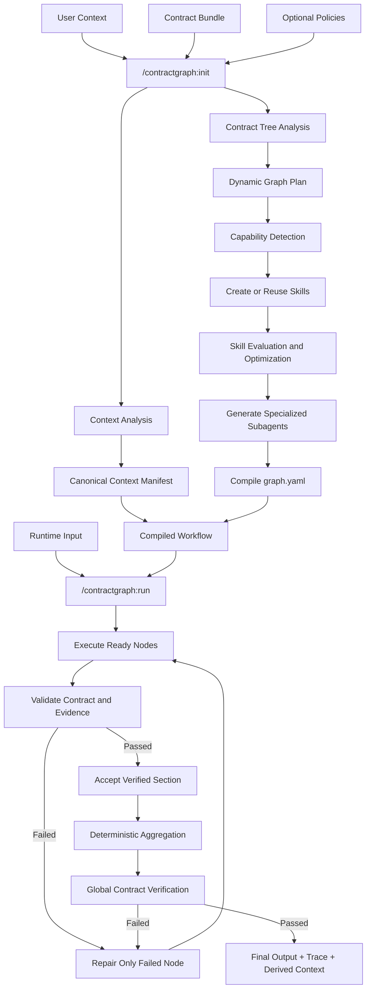

# Architecture

ContractGraph is a Claude Code-native workflow runtime. It is **not** a Python agent framework, web app, API service, or database-backed platform — there is no server, no daemon, and no external model API. Claude Code itself is the runtime; small Python scripts exist only to do deterministic, non-agentic work (hashing, schema validation, JSON merging).

## Core Abstraction

```text
Context defines what is already known.
Contracts define what must be produced.
Policies define what is allowed.
Claude Code designs how the workflow executes.
```

The user supplies two mandatory inputs — `context/` and `contracts/` — plus optional `policies.json`. Claude Code compiles them into a runtime graph, then executes that graph against a runtime input (e.g. a company name, a learner profile). Nothing about the domain (company research, study plans, or any other workflow) is hard-coded into the framework: contracts describe the shape, the compiler infers the rest.

## Two Planes

| Plane | Command | Input | Output |
|---|---|---|---|
| **Init** (compile-time) | `/contractgraph:init` | contract bundle + canonical context + policies | `runtime/compiled/` (graph, manifests, skills, subagents) |
| **Run** (execution-time) | `/contractgraph:run` | compiled graph + runtime input | `runtime/outputs/`, traces, derived context |

Two supporting commands sit upstream of `init`: `/contractgraph:context` scaffolds a minimal `context/` tree, and `/contractgraph:contract` designs a contract bundle. `/contractgraph:validate` runs deterministic structural checks on demand, independent of the other two planes.

Init only needs to rerun when a contract, canonical context file, policy, or core/generated skill actually changes — see [graph-compilation.md](graph-compilation.md).

## Compiled Artifacts

`/contractgraph:init` writes exactly these files under `runtime/compiled/`:

```text
runtime/compiled/
├── graph.yaml                 # + canonical graph.json
├── context-manifest.json
├── contract-manifest.json
├── capability-manifest.json
├── skill-manifest.json
├── agent-manifest.json
└── compilation-report.md
```

Each is produced by one delegated step (see [graph-compilation.md](graph-compilation.md) for the full sequence): structural validation, context indexing, contract manifesting, capability detection, skill reuse/creation, subagent generation, graph compilation + cross-check, compiled-graph validation, and the report.

## Flow



## Repository Shape

```text
contractgraph/
├── CLAUDE.md
├── .claude/
│   ├── commands/contractgraph/   # init, run, validate, context, contract
│   ├── skills/
│   │   ├── bootstrap/            # framework-authoring skills (context-advisor, contract-designer, workflow-compiler, ...)
│   │   ├── reusable/             # verified, domain-neutral capability skills
│   │   └── generated/            # capability skills created for a specific bundle
│   ├── agents/generated/         # one subagent definition per compiled node
│   └── settings.json
├── contracts/<workflow>/         # bundle: contract-bundle.json, node-contracts/, roles/ or other sets, graph.yaml, policies.json
├── context/
│   ├── canonical/                # user-supplied ground truth
│   ├── derived/                  # produced by verified runs
│   └── private/                  # git-ignored PII, never enters skills/agents
├── scripts/                      # deterministic utilities only — no model calls, no reasoning
├── runtime/
│   ├── compiled/                 # this init's output
│   ├── cache/
│   ├── runs/
│   ├── sections/                 # per-node raw outputs
│   ├── traces/
│   └── outputs/                  # final artifacts
├── evals/
└── docs/
```

## Non-Negotiable Boundaries

- Claude Code is the runtime. No LangGraph, no Anthropic SDK, no external model APIs, no API keys.
- No FastAPI/Flask/Django, no Node servers, no databases, queues, or background daemons.
- Python is for small, deterministic utilities only (extraction, hashing, schema validation, JSON merging, cache keys) — never model calls, agent reasoning, or research conclusions.
- JSON is the canonical interchange format; TOON is optional and gated behind a measured token-savings benchmark (`policies.json` → `tokenEfficiency.toonMode: "benchmark_before_enable"`).
- No domain workflow (company research, resume analysis, or any other) is hard-coded into framework core — it lives entirely in `contracts/<workflow>/`.

See [context-model.md](context-model.md), [contract-model.md](contract-model.md), [skill-lifecycle.md](skill-lifecycle.md), [graph-compilation.md](graph-compilation.md), and [privacy.md](privacy.md) for the deep dives.
