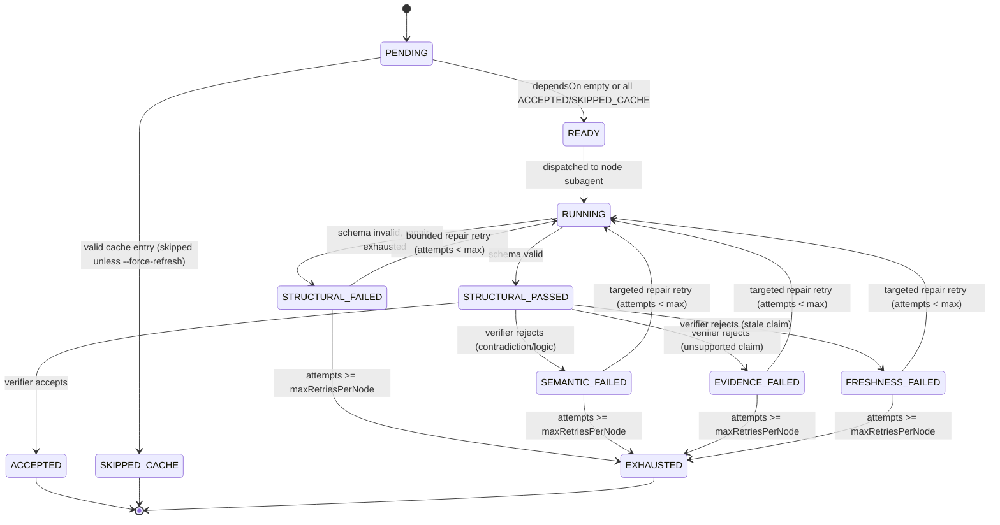

# Execution

`/contractgraph:run` executes a compiled graph (`runtime/compiled/graph.json`) against one runtime input. This is the only command that produces sections, evidence, final outputs, or derived context — `init` never runs a node.

## Flags

```text
/contractgraph:run --input "<companyName>" [--roles ...] [--resume-refs ...] [--job-urls ...] [--as-of <date>] [--force-refresh] [--dry-run]
```

| Flag | Meaning |
|---|---|
| `--input` | The bundle's required runtime input (e.g. `companyName`). |
| `--roles` | Overrides the bundle's default `targetRoles`. |
| `--resume-refs` | Paths to canonical resume(s) to evaluate, when the bundle's node set needs them. |
| `--job-urls` | Job posting URLs to ground role/compensation research in. |
| `--as-of` | Pins `researchAsOf` for freshness calculations instead of using the current date. |
| `--force-refresh` | Ignores cache hits; every node re-executes even if a valid cache entry exists. |
| `--dry-run` | Plans and reports the run — cache hits, execution order, model routing — without dispatching any node or writing sections, evidence, or final output. |

## Run Directory

Every invocation gets its own isolated directory, never shared or overwritten by a concurrent run:

```text
runtime/runs/<run-id>/
├── run.json                   # run id, bundle version, flags, start/end time, final status
├── input.json                 # resolved runtime input (after defaults applied)
├── graph.snapshot.yaml        # frozen copy of the compiled graph this run executes against
├── manifests/                 # referenced context/contract/skill/agent/node-packet manifest hashes
├── node-state/                # one state file per node: status, attempts, timestamps
├── evidence/                  # source-registry.json (deduplicated, incrementally built) + raw search results
├── summaries/                 # one compact {handoff, evidenceRefs, confidence} summary per ACCEPTED node
├── sections/                  # per-node output JSON, immutable once ACCEPTED
├── verification/              # verifier verdicts per node (see validation.md)
├── telemetry/raw/             # per-call usage records this run captured, before normalization
├── logs/                      # dispatch and retry logs
└── final/
    ├── final.json             # merged artifact, only written on global-verification pass
    ├── report.md
    ├── trace.json
    ├── cost.json
    ├── validation-report.json
    └── derived-context.json
```

The snapshot in `graph.snapshot.yaml` exists so a run is never affected by an `/contractgraph:init` that happens to complete mid-run.

## The 19 Steps

1. Confirm a prior successful `/contractgraph:init` — stop if `runtime/compiled/graph.json` is missing or `compilation-report.md` reports a failed compile.
2. Parse flags (`--input`, `--roles`, `--resume-refs`, `--job-urls`, `--as-of`, `--force-refresh`, `--dry-run`).
3. Resolve runtime input against the bundle's `runtimeInputs`: required fields must be present (ask if missing), optional fields fall back to declared defaults.
4. Create `runtime/runs/<run-id>/`; write `run.json` and `input.json`.
5. Snapshot the compiled graph into `graph.snapshot.yaml`.
6. Reference the relevant manifests (context/contract/skill/agent) into `manifests/`, by hash.
7. Compute a cache key per node (`scripts/cache_key.py`) from bundle version, node contract hash, relevant context hashes, runtime input, configured role set, skill versions, agent version, freshness policy, node impl version, **each upstream dependency's current summary hash** (`--dep-summaries`), and the node's own compiled packet hash (`--node-packet`) — a real change to either busts the key; an unchanged upstream summary keeps it stable.
8. Unless `--force-refresh`, check `runtime/cache/` for a valid entry per node; a hit sets that node's state to `SKIPPED_CACHE` without dispatching it.
9. Initialize `node-state/`: every node `PENDING`, then `READY` once its `dependsOn` set is empty or already `ACCEPTED`/`SKIPPED_CACHE`.
10. If `--dry-run`: report the planned execution order, cache hits/misses, and model routing, then stop — no section, evidence, or final file is written.
11. Dispatch each `READY` node to its generated subagent (`.claude/agents/generated/<nodeId>.md`). Independent nodes within a layer are admitted per the **weighted** concurrency caps in `policies.json.execution.concurrency.modes` (`scripts/schedule_plan.py`) — classified `heavyResearch`/`lightSynthesis`/`verifier`/`globalVerifier`, each with its own per-mode cap, not one flat count. The subagent loads only its compiled `runtime/compiled/node-packets/<nodeId>/packet.json` (own contract, declared context refs, dependency-summary refs, evidence-registry ref) — never the whole bundle or all canonical context.
12. Node state moves to `RUNNING`; the subagent writes `sections/<nodeId>.json` (citing evidence as `evidence: [{ref, claims}]` against the run's shared registry, never an embedded `sources[]` array of full metadata) and raw `evidence/<nodeId>/`, preserved regardless of outcome. New sources are folded into `evidence/source-registry.json` (`scripts/source_registry.py`), deduplicated by normalized URL.
13. Structural validation (`scripts/validate_node_output.py`) against the node's `outputSchema`. Invalid JSON/schema triggers one bounded structural repair (haiku); persistent failure → `STRUCTURAL_FAILED`.
14. A structurally-valid node (`STRUCTURAL_PASSED`) is dispatched to `section-verifier` — never the producing subagent — for semantic, evidence, and freshness verification (see [validation.md](validation.md)). Its verdict is exactly `scripts/schemas/verifier-verdict.schema.json`'s shape — `additionalProperties:false` means it cannot smuggle in a rewritten `content`/`section` field even if it tried.
15. A verifier rejection routes to `SEMANTIC_FAILED`, `EVIDENCE_FAILED`, or `FRESHNESS_FAILED` and triggers a **targeted** repair of only the producing node, using the verifier's `repairInstructions` — never a full regeneration — up to `policies.json.execution.maxRetriesPerNode`.
16. A verifier acceptance moves the node to `ACCEPTED`; its `sections/<nodeId>.json` becomes immutable, `scripts/build_dependency_summary.py` writes its compact `summaries/<nodeId>.summary.json`, and its dependents become `READY` once every entry in their `dependsOn` is `ACCEPTED` or `SKIPPED_CACHE`.
17. Once every required node in the bundle is `ACCEPTED`/`SKIPPED_CACHE`, deterministic aggregation (`scripts/merge_verified_sections.py --evidence-registry evidence/source-registry.json`) merges only accepted outputs — resolving each section's `evidence[].ref` against the run registry — into one candidate final artifact.
18. Global verification (opus, `global-verifier`) checks the candidate artifact against `contract.bundle.json.globalValidation[]` and `contract.schema.json`. Failure routes back to step 15 for only the implicated node(s) — never a full run restart.
19. On global pass, write `final/` (final artifact, report, trace, `cost.json` via `scripts/telemetry_normalize.py` — normalized from whatever Claude Code/OpenCode/local telemetry the run actually captured, unavailable metrics left `null` and never fabricated, validation report, derived-context) and any new derived context. On failure after exhausting retries, report the run incomplete with the specific failing node(s) named — `final/final.json` is not written as if the run were complete.

## Node State Machine



Only `ACCEPTED` and `SKIPPED_CACHE` unlock dependents. A node's own producing subagent never renders its verdict — that is always `section-verifier`'s job (`policies.json.execution.workerCannotSelfApprove`). Each retry increments the node's attempt count in `node-state/<nodeId>.json`; the node-state file, not conversation memory, is the source of truth for "how many attempts remain."

## Controlled Parallelism

`policies.json.execution.maxParallelNodes` is **4** in both the company-research and study-plan bundles (the earlier "5" here was a documentation error, not a policy value — `policies.json` is always the source of truth). That integer is kept only as a legacy aggregate ceiling.

The real admission logic is **weighted per concurrency class**, `policies.json.execution.concurrency.modes`:

| Class | How it's detected | `default` cap | `tokenEfficient` cap | `timeBounded` cap |
|---|---|---|---|---|
| `heavyResearch` | agent has WebSearch/WebFetch | 2 | 1 | **2** |
| `lightSynthesis` | Read/Write only | 3 | 2 | 3 |
| `verifier` | `section-verifier` | 2 | 1 | 2 |
| `globalVerifier` | `global-verifier` | 1 | 1 | 1 |

`scripts/schedule_plan.py` computes admission from this table — it never applies one flat count across every node regardless of what that node actually does. The one rule that never bends: **`heavyResearch` stays ≤2 in every mode**, including `--time-bounded` — time-bounded only raises `lightSynthesis`/`verifier` throughput for lower wall-clock, it never raises the concurrent web-research burst size. Nodes across layers never run out of dependency order — a node with an unresolved `dependsOn` entry stays `PENDING` regardless of available capacity.

## Retry Isolation

A retry re-dispatches only the failed node, carrying the verifier's `issues`/`repairInstructions` forward. It never restarts the run, never re-verifies an already-`ACCEPTED` node, and never regenerates from a blank slate — the producing subagent sees exactly what was rejected and why.

## Dry Run

`--dry-run` executes steps 1–10 only: it resolves input, computes cache keys, and reports the plan (what would run, what would be skipped, what model each node would use) with no side effects — no `sections/`, `evidence/`, or `final/` files. Use it to validate a runtime input or inspect cache behavior before spending a real run's budget.

See [validation.md](validation.md) for what happens inside structural/semantic verification, and [token-efficiency.md](token-efficiency.md) for the caching model in full.
